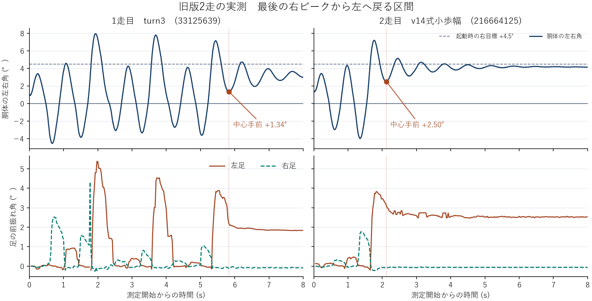

# arrival1で歩行が改善したか　2026年11月22日検証

**連続歩行の改善は未確認。** Downloads以下187ファイルと研究ワークスペース以下342ファイルのRWLOGメタデータを調べた。重複を含み得る529ファイル中に `arrival1` または `walking_profile=right_arrival_v1` の実走はなかった。Camera Rollの最新動画は11月20日19時04分開始で、同日20時台に保存された下記2ログへの対応は確認できない。未回収の機体ログや別端末の保存物はこの調査の対象外。

## 最後に実機で起きたこと

11月20日の先行8走と直近2走を原本から展開し直し、すべてCRCが一致した。直近2走はどちらも30秒記録された。設定±8°のうち起動目標4.5°の段階で交互の胴体ピークが途絶えた。

| 旧版の試行 | 最後の右ピーク | 左への戻りで最初に折り返した時刻・位置 | その付近の足角（左／右） | 25〜30秒の胴体左右角の中央値 |
|---|---|---|---|---:|
| 33125639・turn3 | 5.438秒、+7.15° | 5.832秒、+1.34° | +2.21°／−0.12° | +3.22° |
| 216664125・v14式小歩幅 | 1.758秒、+7.20° | 2.121秒、+2.50° | +3.06°／−0.08° | +4.12° |

両走とも最後の5秒の25 ms枠は200/200で左右の角度を観測した。元画像の番号の組は193組と194組あり、各足の最大値と最小値の差は1走目で左0.021°／右0.018°、2走目で左0.081°／右0.014°。カメラの記録は続いた。胴体が同じ側で揺れた後、左右の足角もほぼ一定に収束した。

11月13日にユーザーが「小さい歩幅で歩けていた」と評価したv14実機では、胴体の交互ピークが79件・80件、最後は29.855秒・29.777秒だった。11月20日の両走は13件・5件だった。ピーク件数は歩数に換算できない。旧v14では映像に緩やかな前進が見えるが、これら4走共通の床上歩幅・速度の測定値は揃っていない。[11月13日の実機記録](https://github.com/temesotejam/rw-walker-motion-control/blob/ce7d01871b3b31cd5e061fc813d8166bb65d4e13/analysis/2026-11-13-walking/v14実機2試行_172594684_294107213.md)

## 右ピークを当てる能力と通電幅を決める能力

先行8走で抽出した正側の通常ZEROは92件。次の右ピークはすべて記録され、予測電荷が従来モデルの適用範囲を超えた1件を除く91件（通電64、惰行27）で係数を決めた。直近2走の6件を加えた抽出表98行は、過去に保存した表と全列一致した。下表の誤差は、そのとき**実際に選んだ幅**に対して予測した右ピークと、その後の実測ピークの平均絶対誤差。短くした候補幅で生じた角度は測定していない。

| 検証条件 | 件数 | 従来式 | 新しい到達式 | 新式の方が実測に近い件数 |
|---|---:|---:|---:|---:|
| 先行8走から走行を1本ずつ外し、その走行を予測 | 91 | 1.39° | 0.57° | 76 |
| 上記のうち、起動目標・通電・適用範囲を満たす判断（7走） | 15 | 1.65° | 0.93° | 13 |
| 直近2走、通電あり | 4 | 2.93° | 0.88° | 4 |
| 直近2走、惰行 | 2 | 0.32° | 0.97° | 0 |

直近2走は不具合の発見に使い、係数の学習から外した。事前に予告した独立実験ではない。各走内の連続した半周期は共通の機体状態を引き継ぐため、91件の独立走行を実施したとは解釈できない。走行単位で外す検証では係数を再推定したが、機上の適用範囲は現在の値を固定した。

**電荷を使わなくても同程度に当たる範囲があった。** 新式は速度の二乗と「速度×予測電荷」から次ピークの名目位置エネルギーを推定する。同じ先行データで電荷項を外して非負係数を求め直すと、8走をすべて使った場合には速度の係数もゼロとなり、右ピークを常に6.65°とする比較式になった。直近の通電4件の平均誤差はこの一定値で0.873°、新式で0.876°。走行を1本ずつ外した起動中の15件でも、電荷なし0.889°、新式0.928°だった。一方、惰行や目標の異なる段階も含む先行91件では、電荷なし1.486°に対し新式0.571°。電荷には広い範囲で予測情報がある。狭い起動条件で「何ms短くすると何度変わるか」を、この比較だけからは確定できない。モータ電流を流す時間は当時の制御が状態に応じて選んでおり、独立に振った量ではない。

| 旧版の正側判断 | 元の指令での実測 | 従来予測 → 新式での予測 | 元の幅 → 現在の候補幅 | 先行8走のうち1走ずつ外したときの候補幅 |
|---|---:|---:|---:|---:|
| turn3・1.705秒 | +7.95° | 4.58° → 7.44° | 54 → 23 ms | 21〜27 ms |
| turn3・3.469秒 | +7.80° | 4.62° → 6.94° | 43 → 18 ms | 17〜22 ms |
| turn3・5.217秒 | +7.15° | 4.62° → 5.51° | 28 → 18 ms | 16〜21 ms |
| 小歩幅・1.544秒 | +7.20° | 4.56° → 7.70° | 50 → 18 ms | 16〜21 ms |

3件の18 ms候補は、それぞれの角速度±3°/sかつ予測電荷±1 mA·s内に先行通電例が0件。23 ms候補でも1件だった。減量する方向はどの走行を外しても同じだったが、18 ms・23 msを最適値とする実験的根拠は足りない。小歩幅の50 msはその保存状態に新式を当てた比較で、小歩幅ボタン自体は従来の式を使う。[近傍の実走との照合](nearby-inputs.md)

## 右への振れを抑えれば左に戻れるか

起動目標4.5°に限定し、右ピークから1秒以内に次の左ピークを記録したかを調べた。末尾に1秒の観測時間が残らないピークは除外した。先行8走では右7°以上でも3件中3件で左に戻り、右7°未満は31件中30件だった。戻れなかった先行例の右ピークは+6.20°。直近2走では7°以上は4件中2件、7°未満は6件中6件だった。

turn3の同じ試行で比べると、+7.95°と+7.80°の後には左向きの補助を28 ms、33 ms実行し、胴体が+1.7°以下に入った最初の角速度は−23.90、−24.75°/s。いずれも中心を通過した。+7.15°の後には19 msの補助を実行したが、同じ位置で−8.88°/sに落ち、中心の手前で折り返した。支持移行の途中で残る左向き速度が、この3件の成否を右ピークよりよく区別した。何が速度を奪ったかについて、足裏荷重、接触の瞬間、滑りと床上変位の実測値はない。

## 現行ファームで検証できた範囲

同じ実装のホスト試験では、1走目1.705秒の事前状態から、元の54 msに対して23 msを選択し、モータ送信スタブと半周期の通電枠に23 msが渡った。実際のモータでの通電は未検証。新式は比較用小歩幅を除く標準±8°の起動目標4.5°、無補助の右向き通常ZERO、かつ有効範囲にある元の通電候補にだけ働く。足角・左右荷重を新式の説明変数にはしていない。左へ戻る補助はturn3の処理を使う。足と胴体の予測から開始時点も選ぶ支持移行MPCは `output_enabled=false` で、記録専用である。[入力選択](../../src/walking_energy_runner.inc) · [支持移行予測の記録](../../src/support_transfer_audit.cpp)

ここで使うQはモデルが予測した電荷。54 msの例では計画幅の予測が9.88 mA·s、通電中の有効なモータ電流標本の絶対値を時間積分した値は13.58 mA·sだった。区間の実電流積分からも、床からの反力や胴体に伝わった実仕事までは求まらない。

実機の比較では、`walking_profile=right_arrival_v1` を確認し、`right_arrival_checked`、`right_arrival_base_ms`、最終幅 `guarded_ms`、`executed` と実行時間を先に見る。新式の最終到達予測は `right_arrival_final_j`、従来式で同じ幅を評価した角度は `predicted_next_peak_amplitude_deg`。右の実測ピーク、次の左中心通過と左ピーク、反対の足の振り出しまでを順番に照合する。歩行改善の判定には、同じ床・向き・初期姿勢・同程度の電池条件で、交互の一歩が続いた時間と同じ時間窓（例として開始後12秒）の両足中点の床上前進距離を動画で比較する。

十走を標準コンバーターで展開し、各走のIDをフォルダ名にして同じ親ディレクトリに置く。`python -B analysis/2026-11-20-ab-trials/verify_arrival.py <親ディレクトリ>` で集計を再現できる。波形は `plot_observed_returns.py <親ディレクトリ> <出力PNG>` で作成する。[検証スクリプト](verify_arrival.py) · [作図コード](plot_observed_returns.py)
