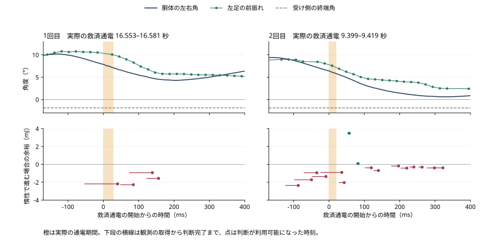

# v39-carry1の歩行2試行と停止時の入力

両試行で左右の足が交互に床の格子に対して前進した。1回目は約17秒、2回目は約9.8秒で足が止まり、測定終了まで自立した。開始後4〜8秒の前進速度はそれぞれ0.84・0.83小区画/sだった。1回目の8〜16秒では、手前へ7.40小区画、画面左へ1.47小区画移動した。速度と進行方向は映像の足裏白印中点から求めた。足が戻る速さ、支持移行後の胴体速度、左右の一歩の時間と合わせて検証できる。[映像の同期・交互前進の根拠](video.md) · [床上の速度・方向と同時刻の足角](gait-observables.md)

## 自立したまま止まる直前

| 測定値 | 1回目 69728952 | 2回目 205922296 |
|---|---:|---:|
| 最後の右側ピーク | 16.419秒、+10.18° | 9.232秒、+9.41° |
| 左向きの救済通電 | 16.553〜16.581秒、28 ms | 9.399〜9.419秒、20 ms |
| 救済時の胴体の角速度の大きさ | 22.2°/s | 23.0°/s |
| 初めに折り返した胴体角 | +4.29° | +0.61° |
| 25 ms周期で発行した足角のうち両足が有効 | 1,188 / 1,199 | 1,197 / 1,199 |

最後のパルスの開始時にはまだ左向きの速度があり、両試行とも機械的0°まで届かなかった。左の受け足の円弧入口は今回の姿勢で0°を越えた約−1.9°にある。歩行が続いたかどうかは床格子で、どの揺れが届かなかったかはIMUで確認した。足裏の実荷重と衝突によるエネルギー損失は、この計測では個別に同定できない。

1回目、切替前には16.454秒と16.476秒の観測に基づく不足の予測が実通電前に完了していた。受け側でも16.501秒の観測で惰性の余裕を−2.187 mJと見積もったが、結果が利用可能になったのは16.594秒で実通電終了後だった。2回目の受け側での早い不足予測は9.277秒の観測で−2.364 mJ、計算完了は9.312秒で救済の選択前だった。その後、停止直前に惰性で届くという予測が2枠続いた。当時の実測電流はゼロ指令から18・38 msのもので、実機は円弧入口の手前で折り返した。

## 改修の検証

4走行で実際に選択された11回の救済を、判断時刻までの情報で再生した。7件は延長を選んだ。今回の1回目の最後は28 msから30 msへ延び、ZERO後に50 ms残る。今回の2回目は足姿勢から27 msが候補になるが、それまでに同方向の主入力を72 ms使った履歴があり、現行の80 ms枠で上積みする余地がないため20 msを維持する。旧試行でZEROを通過した7件すべてで、改修後に残る時間には実際の後続主入力が収まった。変更後の機体が同じ動きをするかは未測定。[11件の入力幅・主入力時間・再生手順](aid-replay.md)

carry2では実通電のうち、左への救済をすでに選んだ時に円弧までの必要仕事を調べ、次の主入力の余地があれば幅を延ばす。今回の目的は、まだ左へ動いている間に支持移行へ必要な仕事を供給すること。候補幅だけで歩行結果は予測できない。次の実験で、実測電流、0°を通過したか、円弧入口で左向きの速さを残したか、次に右足が前進したかを同じ半周期で確認する。

記録用予測では、惰性判定の連続性にゼロ指令後の実測電流を加えた。前述の2枠は新条件では惰性が2回続いたと扱わない。また、モデル値を変えずに計算を短縮した。今回2本と前回2本の2,001枠で、開始・幅・モデルの数値を各枠で照合した。今回2本の受け側予測のPC演算は67%・70%短縮。実機での計算完了は次回RWLOGの `ready_after_us` で比較する。[計算時間・再現手順](bench-plan.md) · [制御仕様](../../docs/SUPPORT_TRANSFER_V39.md)

元のRWLOGは `energy_control_autonomous_run_1_69728952.rwlog`（2,826,501 bytes、CRC32 `6c2c17fc`）と `energy_control_autonomous_run_2_205922296.rwlog`（2,739,515 bytes、CRC32 `0c034401`）。両方のCRCと起動版を確認した。図は変換済みの各試行フォルダーを引数にして [plot_final_aid.py](plot_final_aid.py) で再生成できる。
