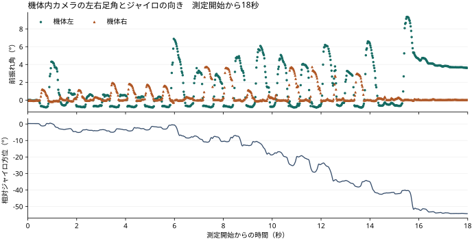

# 旋回中の右足の前振れと床上の前進

測定50784949では、歩行の後半に機体右の前振れが小さくなり、動画でも同じ側の足が床格子に対して進んだ量が小さかった。機体は両足の実測角を取得し、左への支持移行を助ける通電に使った。左右の一歩の差を旋回として判定する操舵処理は無効だった。

## 機体から見た足角

2〜4秒では機体右の方が大きく振れている。次いで7.719〜15.511秒に完結した胴体揺動9周期では、すべての周期で右足の最大前振れ角が左足を下回った。周期は胴体の一方のピークから次の同じ側のピークまでとした。14〜16秒に判定可能だった95画像は、すべて左右とも有効だった。右マーカーの横位置の5〜95パーセンタイル幅は1.85画素、左は67.92画素で、カメラ上でも右の動きが小さい。

| 測定時刻 | 機体左の前振れ角 | 機体右の前振れ角 |
|---|---:|---:|
| 2〜4秒 | 0.61° | 1.77° |
| 6〜8秒 | 5.87° | 3.68° |
| 14〜16秒 | 9.16° | 0.26° |

表は、撮影時刻で区切った同時に有効な両足の実測角の95パーセンタイル。角度は前振れが正。14〜16秒を25 ms周期の発行値で集計しても左9.19°、右0.30°だった。定周期推定は測定全体で1,200枠を発行し、1,196枠で左右とも有効だった。

## 床格子と外部映像

測定8〜14秒に床格子の手前向きに進んだ量は、画面左の足裏白印が5.05小区画、画面右が6.24小区画。画面左は約19%小さい。中点は手前へ5.65、画面左へ1.85小区画移った。平均進行方向は手前から画面左へ約18°。両足が見える8.138〜14.384秒について各周期の中点の進行方向に沿って比べると、7周期中5周期で画面左の足が短かった。右足も歩行中に前進している。

動画の画面左が機体右に対応することを時系列でも照合した。正面に近い2〜8秒、画面右の白印が左の白印より手前に出る量と、機体左足角から右足角を引いた値の相関は+0.92。機体が大きく横向きになり、片足が隠れた後の歩幅は比較から外した。ここで測っているのは白印の床面への投影で、足裏の正確な接触位置や滑りは未計測である。

胴体の白丸2点を結ぶ線の角度をIMUの左右角と照合し、動画約6.73秒を測定開始に合わせた（測定0.5〜5秒の相関−0.991、映像は約30 fps）。マット8か所を前回の映像と照合し、画面右2・下5画素のずれを補正した上で[床格子の換算方法](../2026-11-20-carry1-trials/gait-observables.md)を使用。8秒と14秒の各時点で前後0.4秒の座標を平均して差を取った。7周期の比較は同じ負側の揺動ピーク間で行った。

## 実制御での認識

| 救済を決めた時刻 | 判断に使った機体左 / 右の実測角 | 従来幅 → 実際の通電時間 |
|---|---:|---:|
| 9.670秒 | +5.21° / +0.01° | 19 → 19 ms |
| 14.123秒 | +5.25° / −0.07° | 20 → 30 ms |
| 15.644秒 | +9.04° / +0.003° | 18 → 21 ms |

3件とも定周期の発行後に届いた最新の同一画像で左右を確認した（`arc_foot_source=2`）。14.123秒の救済後は14.252秒にZEROを越えて主入力41 msが続き、15.644秒の救済後はZEROを越えなかった。姿勢の左右差を使った目的は、左足が前に残ったまま支持を移すときに揺れが止まるのを防ぐことだった。旋回は最初の延長より前から進んでいる。

相対ジャイロ方位は測定8秒で−10.49°、16秒で−51.78°、17秒で−54.12°。磁気補正のないジャイロ積分による機体の向きで、床上で測った18°は移動経路の向きである。計測中の全7,552サンプルで `steering_reason=8`（無効）、`steering_delta_deg=0`。機体側で「右の一歩が短い」と判断するには、左右が一本ずつ振り出し終わった単位で比較し、その時点までの相対方位変化を照合する必要がある。前振れの大小だけから床に対する接地歩幅や曲がった原因を一意には決められない。

入力は `WIN_20261120_17_52_01_Pro.mp4` と `energy_control_autonomous_run_1_50784949.rwlog`。CRC32 `e05275ed`、起動版 `walking-support-transfer-v39-carry2` を確認。グラフは元ログを `tools/convert_rwlog_to_csv.py` で展開し、[plot_turn.py](plot_turn.py) に展開先を指定すると再生成できる。
