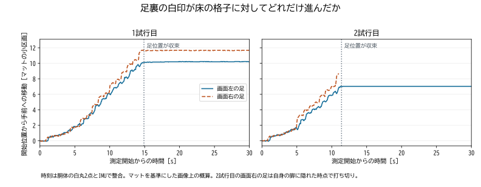
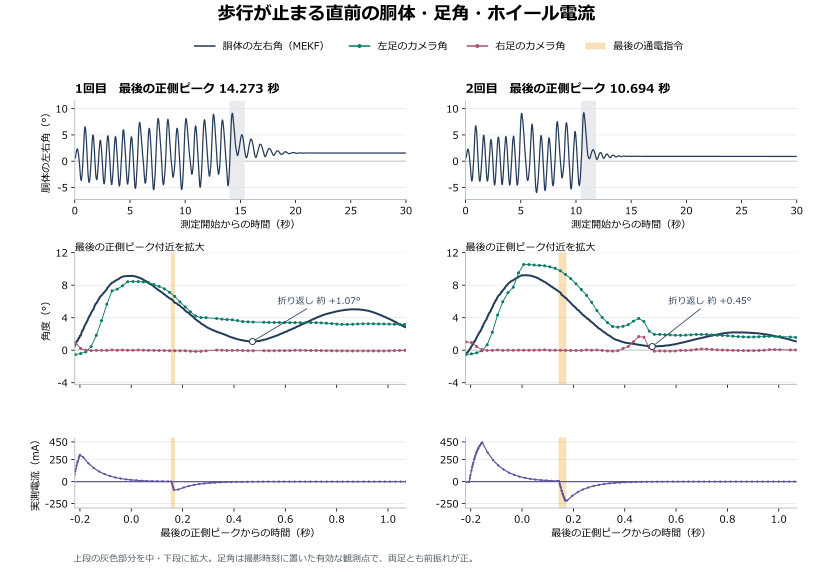

# v39-webfix3 実歩行2試行の比較

同じ2試行を使って、[支持切替後のエネルギー予測](receiving-replay.md)と、[それまでの半周期から受け足の戻りを予測する方法](receiving-foot-history.md)も検証した。

2026年11月20日の測定。1回目・2回目とも実際に足を交互に進め、その後に向きを変えて自立したまま停止した。どちらも30秒の測定を完了し、ダウンロードされたRWLOGはヘッダーで定まる長さ、末尾のCRC32、および記録された本体版が一致した。ファイルから通信の再試行回数は分からない。

| 測定開始を0秒とした観測 | 1回目 · 69501075 | 2回目 · 224021399 |
|---|---:|---:|
| RWLOGのバイト数 / CRC32 | 2,793,564 / `30307273` | 2,751,096 / `0efedf71` |
| 動画で足の前進が止まった時刻 | 約14.9秒 | 約11.4秒 |
| 左足 / 右足のカメラ最大前振れ | +8.45° / +2.96° | +10.55° / +4.40° |
| 最後の胴体正側ピーク | +9.15°（14.273秒） | +9.22°（10.694秒） |
| 最後の負方向の通電指令 | 14.429〜14.441秒、12 ms | 10.838〜10.865秒、27 ms |
| その入力に伴う実測電流の負側ピーク | −94 mA | −217 mA |
| 胴体が負側へ戻って最初に折り返した左右角 | +1.07° | +0.45° |
| 最後の5秒の胴体左右角 | +1.54〜+1.57° | +0.90〜+0.92° |

## 動画で確認できた前進

両方とも測定6〜8秒付近で、一方の足裏の白印が手前へ進み、もう一方がほぼ同じ位置に残る動きが左右交互に現れた。マット上の白印の手前方向への変位は、1回目は画面左で約10.2小区画、画面右で約11.7小区画。2回目は画面左で約7.0小区画、画面右は脚に隠れる直前までに約8.7小区画だった。その後も映像で転倒や手で支える動作は見られない。

動画は1回目が `WIN_20261120_14_42_44_Pro.mp4`、2回目が `WIN_20261120_14_45_18_Pro.mp4`。胴体の左右の白丸が作る線の角度をIMUの左右角と合わせると、測定開始は動画の7.12秒・7.60秒付近。初期4秒の符号つき相関は両方とも−0.999で、映像とIMUの符号は逆となる。これは約30 fpsの映像を用いたIMU基準の同期で、LEDによる独立同期は確認できていない。

足裏位置は、固定カメラの画像で横格子線18本を2列（横座標455、760 px）で対応付け、白印の位置を囲む格子線の間隔で換算した。これにより奥行きによる見かけの格子間隔の変化を反映した。白印の投影変位には方向転換や足の姿勢の影響が入る。床上の荷重移行の瞬間、滑りの有無、重心の移動距離をこの値からは決められない。

## 最後の戻りで実際に起きたこと

両試行とも、左足の最大前振れは最後の正側ピークの約6 ms後だった。そこから胴体は負方向に戻り、救済入力も実行したが、機械的0°に届く前に折り返した。1回目の救済終了以降は右足がほぼ0°にとどまり、2回目には右足が11.149秒に約+1.68°だけ振れた。その先の交互歩行にはつながらなかった。通電後の半周期の時間枠は1回目で68 ms、2回目で53 ms残っていた。

実出力はv19が決め、v39は支持移行を予測して候補を記録した。1回目の14.427秒と2回目の10.828秒の入力データを本体と同じCAD計算へ戻すと、左足裏の最低点は右よりそれぞれ約0.99 mm、1.29 mm低かった。v39は両時点とも `gate_mask=0`、`outside_approach` と記録した。次の支持足が計算上すでに低い場合、現行の予測器はその先の残留速度や必要仕事を評価する前に処理を終える。これらの高さはモデル値であり、実際の足底荷重は測っていない。[支持移行の判定](../../src/support_transfer_plan.h)

成功した戻りも比較できる。2回目の5.251秒にも左足推定+8.74°、CAD上で左足が低く、同じ `outside_approach` だった。v19はその後18 ms通電し、5.446秒に負方向のZERO通過を記録した。同試行の最後は27 ms通電しても届いていない。次の検証では、この二つの半周期で、足が戻る速度、胴体が失った速度、電流の立ち上がりと、支持移行後に必要な仕事を時系列で比較できる。

## 足角の取得と時刻

| RUNNINGかつ開始以後に撮影した画像の集計 | 1回目 | 2回目 |
|---|---:|---:|
| 両足カメラ観測有効 / 撮影フレーム | 1,409 / 1,412 | 1,414 / 1,414 |
| 25 msの発行枠 / 抜け | 1,199 / 0 | 1,199 / 0 |
| 同じ発行枠で左右とも有効な推定値 | 1,194 / 1,199 | 1,192 / 1,199 |
| 両足有効画像の記録から制御側初回受取までの中央値 / 95百分位 | 26.63 / 31.94 ms | 26.62 / 31.70 ms |

終盤も足角の観測は続き、21〜30秒の左足はそれぞれ約+2.28°と+1.41°に落ち着いた。発行時に参照できる画像がなかった最初の1枠と、元観測が75 msを超えた枠では両足の有効な推定値が揃わなかった。

胴体・足角・電流の図は、既存の `tools/convert_rwlog_to_csv.py` による各試行の展開先を順に渡し、`python -B plot_last_return.py <1回目の展開先> <2回目の展開先>` で再生成できる。
