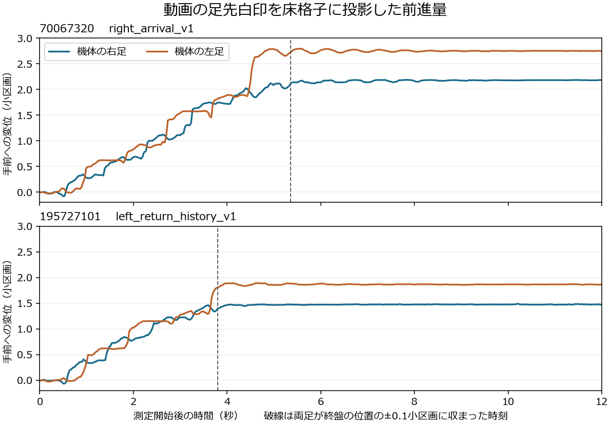
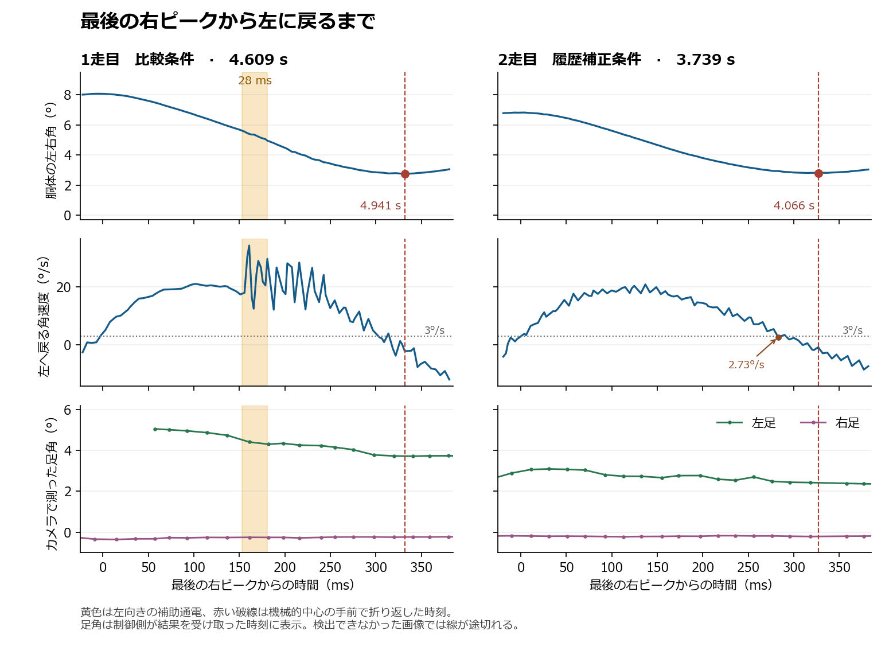

# 11月22日　右から左へ戻れず停止した2走

比較条件、新しい左戻り補正条件の順に実走した。両方とも初めは左右の足が交互に前へ出た。最後は左足を前に出した状態で胴体が右側から戻り切らず、次の右足の振り出しが続かなかった。新条件による通電幅の延長は0回で、その効果は今回の実走では判定できない。

## 動画で測った前進と実機の最終状態

| 実測項目 | 1走目　70067320 | 2走目　195727101 |
|---|---:|---:|
| 選択条件 | `right_arrival_v1` | `left_return_history_v1` |
| 開始から12秒までの右足先・左足先の前進量（床格子の小区画） | 2.18・2.75 | 1.48・1.87 |
| 両足先の平均前進量（同上） | 2.47 | 1.67 |
| 両足先が終盤位置の±0.1小区画に収まった時刻 | 5.36 s | 3.80 s |
| 隣り合う胴体ピーク間で、期待した側の足がより前進した区間 | 10 / 10 | 7 / 8 |
| 最後の右ピーク | 4.609 s、+8.08° | 3.739 s、+6.83° |
| 左へ戻る途中の折返し（IMU取得時刻） | 4.941 s、+2.76° | 4.066 s、+2.81° |
| 有効な両足角を得た40 Hz周期枠 | 1190 / 1199 | 1195 / 1200 |

両ログともファームは `walking-support-transfer-v39-return-history1`。CRC一致、30秒で `FINISHED`、ESTOPは0件。最後まで40 Hz周期枠の取りこぼしは0だった。画像の記録時刻から認識結果の制御側受信までの中央値は両走とも約26.4 ms。2走目では最後の右ピークから700 msの28枠すべてで左右足角が有効だった。

動画では足先の白印を追い、同じ床格子に対する手前方向の変位を測った。2本の動画で床の固定8点のずれの中央値は0画素。スタートは胴体の白印を結んだ線とMEKF角の波形を走ごとに合わせ、動画の6.834秒と6.729秒に置いた（最初の4秒で相関はいずれも約−0.997、約30 fps）。この方法で分かるのは足先の投影位置で、足を浮かせる影響を含む。接地時刻・荷重・滑り・実寸は測定していない。2走目の2.519〜2.886秒は左右とも約0.06小区画しか進まず、振り出し側を識別しにくい。終盤位置の許容幅を±0.05小区画に狭めると、収束時刻は5.90秒、3.91秒となる。両走とも12〜30秒の540フレームで足先に継続した前進は見られなかった。



## 1走目　左補助は実行された

4.760秒に胴体は+5.72°、左へ戻る速さは18.07°/s。制御側が使えた足角は左+4.74°、右−0.26°だった。足姿勢による既存の補正で指令は22 msから28 msになり、4.762〜4.790秒に実際に通電した。その後は機械的中心の手前の+2.76°で折り返した。左の円弧端の計算値は約−1.90°。中心通過後の主入力に31 msを残していたが、そこまで到達できなかった。

この補助の要求仕事は57.87 µJ、実行幅に対するモデル推定仕事は42.22 µJで、差は約15.65 µJ。この速度域での仕事はモデルの外挿による。単純にこの差の分だけ通電を延ばせば足りるかは未検証。走行の途中には、3.053秒の左補助後に3.132秒で左向きに中心を通過し、3.309秒で左ピークまで戻った例もあった。

## 2走目　足が見えている間に左補助の確認が途切れた

2.228秒に既存の左補助を判断し、21 ms実通電して左向きに中心を通った。この補助には新条件の履歴に必要な円弧端の参照がなく、次の幅を決める過去2件は揃わなかった。最後の実通電は3.521〜3.543秒の右向き22 ms。3.739秒の右ピークから左へ戻る半周期では補助開始も幅延長も0件だった。

| 制御記録の時刻 | 左へ戻る速さ | その時点の判定材料 |
|---|---:|---|
| 3.951 / 3.977 s | — | CAD上の左足裏はまだ右足裏より0.287 / 0.152 mm高い |
| 4.002 s | 7.16°/s | 左足裏が0.171 mm低くなり、減速123.72°/s²。1枚目の確認条件が成立 |
| 4.024 s | 2.73°/s | 2枚の足画像の間のIMU標本。現行の下限3°/sを下回る |
| 4.028 s | 5.40°/s | 左足裏が0.270 mm低く、減速65.55°/s²。2枚目の画像も条件を満たす |
| 4.066 s | — | 胴体が機械的中心の手前で折り返す（IMU取得時刻） |

機上の小さな足角差用の補助は、受け側の足姿勢を別々の2枚で連続確認する。確認中にもIMUを読み、速度が範囲を外れると前の確認を消す。実機と同じC++判定器に2枚の足角更新だけを与えると4.028秒に41.21 µJの補助を選んだ。間の実測IMUを4件すべて与えると選ばず、2.73°/sの1件だけを挟んでも選ばなかった。これは上位の通電許可を有効にして判定器を取り出した再生で、未記録の制御周期や実際に加えなかった入力の効果は再現していない。2枚目から折返しまでは約38 msで、使用中のモデルの電流立ち上がり時定数は31.65 msである。

共通の右向き通常入力にも別のずれがある。2走目の起動段階で37→15 msおよび29→22 msに短縮し、指令幅に対するピーク予測はいずれも約+4.5°だったが、実測は+6.35°、+6.83°だった。右ピークの大きさだけから左への戻りが決まるとは言えず、実際には前者の後には中心を通過した。



## 次に比較する入力

11月20日の先行8走を固定したPCモデルを今回の2走に適用した。+4.5°付近の早期監視は1走目の4.813秒、2走目の3.901秒で折返しを予告した。ログの時系列行で読んだ折返し（4.943 / 4.068秒）まで130 / 167 ms。後続の追加通電がない区間として採点できた今回の9区間で、折返しは2件とも予告し、中心を通過した7件の誤警報は0件。過去データで誤警報があり、今回の2走は少数である。+3°・+2°を使う通常の類似例判定だけでは2走目を見逃した。

1走目ではこの警報は補助終了の23 ms後だった。比較すべき候補は**すでに実行した左補助の開始時刻と仕事量**である。2走目では警報から約100 ms経って、初めて受け足を確認できる姿勢に入った。3.901秒には左足裏への荷重移行を幾何学的にもまだ確定できず、CADの受け側の端が得られたのは4.015秒だった。こちらでは**早い警報で左補助を準備し、左へ戻る運動・足姿勢の推移から受け側を予測して、惰行と早めの通電を比較する**案が対象になる。速度下限の変更だけでは得られる時間が小さい。採否は、左の円弧端で残る速度と、続く右足の実際の前進で評価する。

## 再現手順

入力はDownloadsの元RWLOG 2件とCamera Rollの対応するMP4。PowerShellでリポジトリのルートから実行する。シミュレーターの `--recordings` は先行8走等を展開済みの場所に合わせる。[先行ログの展開手順](../2026-11-22-walking-simulator/README.md)

```powershell
$trialRoot = Join-Path $env:TEMP walker_trial_20261122
python -B tools/convert_rwlog_to_csv.py "$env:USERPROFILE/Downloads/energy_control_autonomous_run_1_70067320.rwlog" --out "$trialRoot/70067320"
python -B tools/convert_rwlog_to_csv.py "$env:USERPROFILE/Downloads/energy_control_autonomous_run_2_195727101.rwlog" --out "$trialRoot/195727101"
python -B analysis/2026-11-22-return-trial/video.py $trialRoot --plot "$trialRoot/floor_progress.png"
python -B analysis/2026-11-22-return-trial/plot_return.py $trialRoot "$trialRoot/return.png"
python -B analysis/2026-11-22-return-trial/replay_small_arc.py "$trialRoot/195727101"
foreach ($trial in '70067320','195727101') {
    python -B analysis/2026-11-22-walking-simulator/simulate.py --recordings "$env:TEMP/walker_arrival1_verification_20261122" --evaluate-run "$trialRoot/$trial" --json-out "$trialRoot/${trial}_eval.json"
}
```
