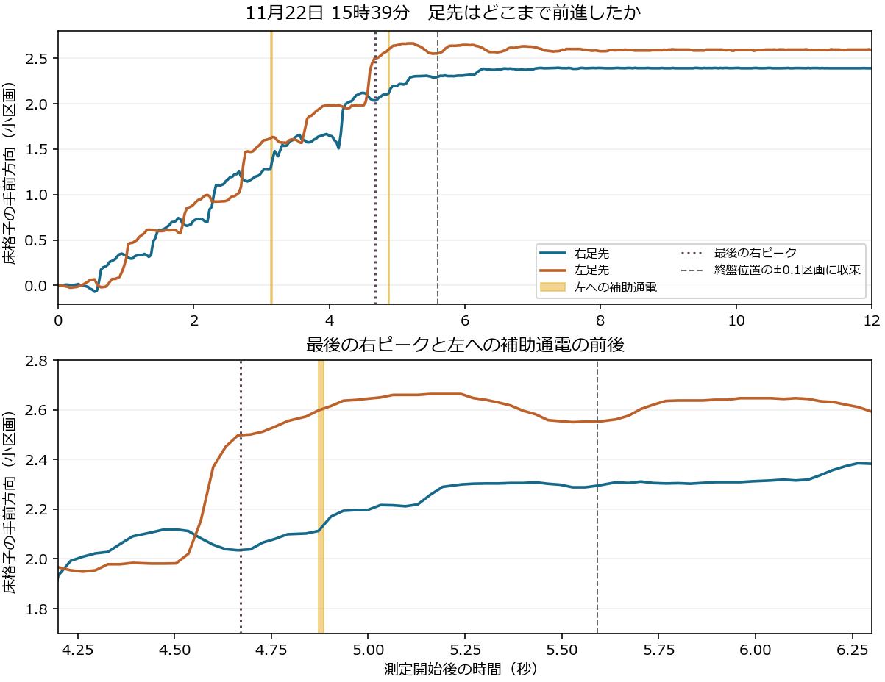
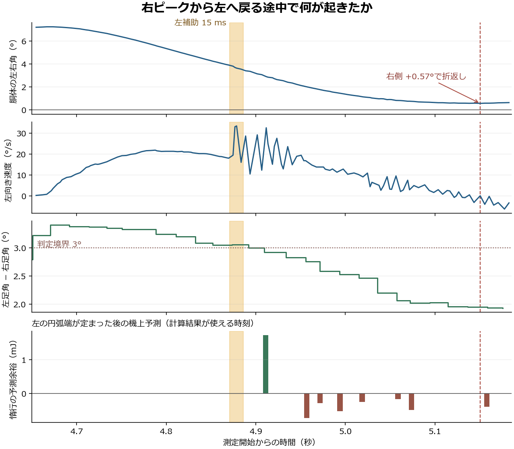

# 11月22日15時39分　左支持を予測する条件での初回実走

`energy_control_autonomous_run_2_135284989.rwlog` と `WIN_20261122_15_39_17_Pro.mp4` を照合した。新条件 `left_return_prediction_v1` の実行をログで確認した。序盤は左右交互に前進し、最後も右足先が少し出たが、胴体が右側から左側へ戻れずに止まった。予測による新規の補助開始も、過去の中心通過速度を使った幅延長も0回だった。

## 床に対してどこまで進んだか

| 測定（同日） | 12秒時点の足先の平均前進量（床格子の小区画） | 両足先が終盤位置の±0.1小区画に収まった時刻 | 最後の右ピークから左へ戻って最初に折り返した胴体角 |
|---|---:|---:|---:|
| 14時40分　右側の到達を補正 | 2.47 | 5.36秒 | +2.76° |
| 14時42分　左戻りの履歴補正 | 1.67 | 3.80秒 | +2.81° |
| 15時39分　左への支持移行を予測 | 2.49 | 5.59秒 | +0.57° |

今回の12秒時点は右足先2.39、左足先2.59小区画。隣り合う胴体ピーク10区間のすべてで、振り出すと予想される側の足先がもう片方より前進した。4.261〜4.670秒は左が0.54、右が0.03小区画前進した。4.871秒の左補助開始から終盤位置までは、今度は右が約0.26小区画前進し、左の正味の移動は約0.00小区画だった。右足が動き出しても、次の支持移行に必要な胴体の左戻りは完了しなかった。

今回の撮影位置で床格子を校正し、床の固定6点を2秒ごとに照合した。114か所の最大ずれは0画素。胴体の白印の傾きとMEKF角で測定開始を動画7.672秒に合わせた（約30 fps、相関 −0.997）。足先の高さの変化も床への投影位置に影響する。実接地時刻、左右の荷重、滑りは未計測。収束の許容幅を±0.05小区画にすると今回の時刻は6.20秒になる。安定した終盤位置は12〜30秒の中央値で求めた。[前の2走の測定方法](README.md)



## 最後の半周期に機体と制御で起きたこと

| 測定開始後 | 観測と判断 |
|---|---|
| 3.127秒 | 先行する左補助を判断。3.129秒から指令幅26 msで通電し、3.168秒には左向き31.39°/sで機械的中心を通過。3.321秒に左側−2.87°まで到達した。 |
| 4.670秒 | 最後の右ピーク+7.27°。ここから左へ戻り始めた。 |
| 4.869秒 | 胴体は右+3.97°、左向き18.35°/s。現在の減速度から推定した停止距離は2.32°。中心の手前で止まる予測に基づき、従来の左補助を選んだ。 |
| 4.871〜4.886秒 | 左へ15 ms通電。要求仕事15.80 µJから求めた17 msに車輪側の制限を適用した。適用幅でのモデル推定仕事は約13.15 µJ。この速度域では外挿値。 |
| 4.892秒 | 制御側が受け取った足角差が、入力付近で初めて3°を下回った。 |
| 4.904秒付近 | 記録された足姿勢からCADで求めた左足裏が右足裏より低くなった。左向き速度は29.29°/s。4.977秒には13.85°/s、5.052秒には3.22°/sまで落ちた。 |
| 5.151秒 | 胴体が中心手前の+0.57°で最初に折り返した。小さな揺り戻しで+0.28°まで近づいたが、その後も中心を越えず、終盤は右+2.32°付近に落ち着いた。 |

入力を決めた瞬間に制御側が使えた足角は左+2.857°、右−0.189°で、差は3.045°。小さい足角差を扱う「3°未満」の範囲を0.045°上回り、別の経路で円弧端までの仕事を計算する条件でも、CAD上の左足裏がまだ0.189 mm高かった。結果として、中心を通過できるかどうかを基準に補助量を決めた。先行する3.168秒に左向きに中心を通れた例はあったが、その速度を参照して必要仕事を増す処理には進まなかった。

足角差の境界を動かすだけで先読みが作動するとは限らない。小さい足角差で先読みするには、別々の観測で60°/s²以上の減速を連続確認する。保存された入力前の4.805秒と4.854秒の値は4.03、50.93°/s²だった。一方、出力には使わない予測計算では、4.728〜4.805秒の4件ですでに左右の足裏高さが35〜83 ms後に入れ替わると見込んでいた。この時刻のずれと、荷重の実測がないことは、必要仕事を求める際の不確かさとして残る。

左円弧端に着いた時点の惰行のエネルギー余裕も、4.914秒に利用可能になった予測では+1.73 mJ、4.957秒の予測では−0.74 mJだった。短い入力直後の一時的な加速だけで残る速度を見積もると、次の支持までの運動を過大評価し得る。これはその場でのモデル予測で、床からの衝撃仕事は直接測定していない。



## 足角の取得と通電終了後の回転

ファームは `walking-support-transfer-v39-return-prediction1`。RWLOGのCRCは一致し、30秒で正常終了した。40 Hz周期の欠落は0枠、左右とも制御に使える足角は1199枠中1196枠。最後の右ピーク後700 msは28枠すべてで有効だった。画像の記録時刻から制御側の受信までは中央値26.05 ms、95パーセンタイル30.09 ms。欠測が原因で終盤の足角を判定できなかった形跡は見られない。

最後の左補助終了直前のホイールは約−12 rpm。ドライバへのゼロ指令から約47 ms後には−93 rpm、約144 ms後には−135 rpmを記録した。ホイールは負方向への回転を速めている間にも、胴体は左向きの速度を失った。起動後の12通電を個別に見ると終了直後の回転数の絶対値が下がったのは8件、上がったのは4件。速度保持は今回試していない。

次に比較したいのは、既に左補助を出す判断をした時点で、足角の差が縮む速さから近づいている受け側の円弧を予測し、その円弧に移った後に残す速度までを一回の必要仕事に含める場合。今回と先行する成功半周期の両方を再生し、開始時刻と通電幅、主入力の残り予算、予測速度と実測速度の差を確かめる。最終的な評価は中心通過、右足先の前進、その次の左足先の前進が続いたかで行う。

## 図の再現

リポジトリのルートから実行する。動画のパスを変更する場合は `prediction_video.py --video` で指定できる。通電図の横軸はログの測定開始時刻。足角は制御側での受信時刻、円弧端の余裕は機上で予測結果が利用可能になった時刻で描く。

```powershell
$trialRoot = Join-Path $env:TEMP 'walker_trial_20261122'
$trial = Join-Path $trialRoot '135284989'
python -B tools/convert_rwlog_to_csv.py "$env:USERPROFILE/Downloads/energy_control_autonomous_run_2_135284989.rwlog" --out $trial
python -B analysis/2026-11-22-return-trial/prediction_video.py $trialRoot --plot analysis/2026-11-22-return-trial/135284989_floor.png
python -B analysis/2026-11-22-return-trial/last_aid_135284989.py $trial analysis/2026-11-22-return-trial/last_aid_135284989.png
```
