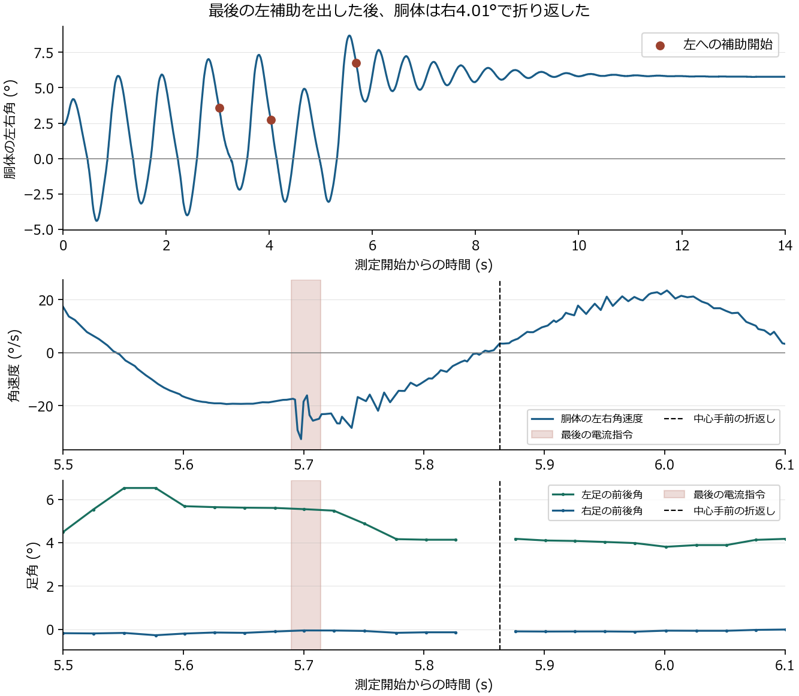

# 歩行が途切れたとき、胴体は中心の右4.01°で折り返した

ログ `41749536` は歩行版 `walking-support-transfer-v39-walk2` / `left_transfer_carry_v2` の30秒測定。CRCは一致し、末尾の状態は `FINISHED`。右→左の中心通過は6回、左右交互のピークは13回だった。前回の3回・7ピークから交互揺動は長くなったが、この試行に床を撮影した動画はなく、歩幅・前進距離は比較できない。



## 相手足へ渡れたときと、止まったとき

実機は3度とも、胴体がまだ左へ17–18°/sで動くうちに補助を開始した。5.687秒の判断が先の2回と大きく違うのは、**始めた地点から機械的中心まで6.74°も残っていた**こと。左足裏が受け側になるというCADの最初の判定も、今回は補助開始前にすでに届いていた。表の中心速度は角度通過を挟むIMU標本で補間した左向き角速度、仕事は機上モデルの推定値。

| 左補助の判断時刻 | 胴体の右傾き | 左向き速度 | 補助指令 | 指令後も残る予測不足 | 次の中心通過 |
|---|---:|---:|---:|---:|---|
| 3.026秒 | 3.64° | 17.67°/s | 17 ms | 23.80 µJ | 3.252秒に4.81°/sで通過 |
| 4.028秒 | 2.82° | 17.27°/s | 25 ms | 14.11 µJ | 4.142秒に18.18°/sで通過 |
| 5.687秒 | 6.74° | 17.76°/s | 24 ms | 14.09 µJ | 右4.01°で折返し |

直前には5.314秒に右向き28.09°/sで中心を通り、右主入力40 msを出して5.554秒に右8.68°まで傾いた。実行時の始動用目標は5.00°で、ピーク角から求めたエネルギーは目標386.19 µJに対し834.30 µJ。右へは目標より大きく振れ、そこから左へ戻る距離が長くなった。

左へ戻る5.687秒では左足が前方5.61°、右足−0.12°。その場の減速55.67°/s²から計算した停止距離は2.83°で、このままなら中心まで3.91°足りなかった。実機では従来の足裏形状補正が基本幅19 msを24 msまで延長した。モデルの要求44.31 µJに対し、逆算30 msをホイール制限で24 msにした予測仕事は30.22 µJ。walk2で追加した、受け足がまだ高い場面の中心前後配分は3度とも動作条件に入らなかった。成功と失敗で残る予測不足がほぼ同じ例があり、この指標単独では区別できない。[当時の入力条件](../../src/return_crossing_work.h)

左足角は5.650秒の5.61°から5.800秒の4.13°へ戻り、右足角はほぼ0°を保った。胴体は5.778秒頃には左向き約15°/s、5.804秒に約10°/sへ落ち、5.858–5.863秒に右4.01°で折り返した。5.903秒に0.2°以上の逆行を確認した。その後の折返し位置は右7.67°、右4.76°、右7.23°と片側だけで揺れた。測定の最後5秒の中央値は胴体右5.80°・角速度の絶対値0.073°/s、足角は左3.51°・右−0.07°。最後の通電は5.690–5.714秒で、半周期の80 ms枠に56 msが残った。中心を通過できず、その後の主入力が開始されなかった。

右側だけで揺れが減衰することは、足が前に出て接触姿勢が変わる機体が、機械的0°以外でも支持され得ることと整合する。重心位置・床反力・摩擦・個々の衝突損失はこの記録から一意に決まらない。定周期足角の両足有効は1199枠中1195枠、周期欠落は0。折返し付近に両足値のない枠があるが、中心に届かず反転する連続した胴体運動はIMUに記録されている。

## 右へ傾き過ぎる前の入力

直前の右向き通過を並べると、4.466秒はひとつ前の左ピーク−3.05°、右向き速度30.18°/s、足角左−0.11°・右+0.36°から惰行で右4.93°へ届いた。5.314秒は左ピーク−3.06°、右向き速度28.09°/s、足角左−0.14°・右+0.33°から、右40 msで8.68°に達した。駆動状態にも差があり、ホイール速度レジスタは−533対−731 rpm、入力計算に使った初期電流は+49.4対−7.7 mA。前者で惰行が足りたことを後者にそのまま当てはめることはできない。

過去8走で決めた右到達の仕事モデルを、目標5°の右向き通常ZEROに限って適用した。15走から、同半周期に補助を受けず、次に右ピークを観測できた23件が該当。右主入力のあった10件中9件で短縮が選ばれ、いずれも実際の右ピークは5°を超えていた。モデルを決めた8走での短縮は1/1件（元は5.16°）、残る7走では8/9件（元は6.65–8.68°）。後者の8件は元の入力で次の左ピークが続いた4件、続かなかった4件。5°以下の13件はすべて元から惰行で、この適用による入力の変更はない。元の主入力でも5°に満たなかった例は記録に含まれず、弱い右移行時の評価は残る。[右到達の既存モデル](../../src/right_arrival_energy.h)

この走行の5.314秒だけを固定すると、予測到達は惰行で265 µJ、40 msで524 µJ。目標386 µJに近づける幅は26 msとなった。元の40 msに対しても予測値は測定したピーク角から求めた834 µJを下回る。さらにこの走行では2.599秒の23→22 msと3.574秒の38→33 msも先に変わる。これらは同じ記録上の別々の判定点を固定した結果で、新しい幅を順番に出した後の実際の体勢は次の実験で確かめる。

## 通電を切った後

5.714秒にドライバは−1200 mAから0への指令を受理。実電流は解除直前の−190 mA、直後の最初の読出し−161 mAから減衰し、解除から折返しまでに左向き12.13 mA·sが流れた。ホイールの累積位置から推定した速度は解除付近の約−252 rpmから約15 ms後の−282 rpmまで増速した後、約145 ms後には−230 rpmに戻った。速度レジスタにはこれより遅い応答が記録されている。**電流を切った瞬間に逆電流が出た証拠はなく、回転が減速する後段は実在する。** 回転の減速、胴体の運動、モータ端子の実電流は別々に評価する必要がある。[ホイール位置・速度・仕事の照合](release.md)

## 失速中に入力の機会を設けた場合

5.779秒の時点で、元の24 msの通電はすでに完了していた。約3 ms後にもう一度左向きに通電する仮定で、以前の8走から作った局所モデルに0/10/20/30/34/40 msを入力した。150 ms後の胴体の右傾きはそれぞれ2.25/2.02/1.82/1.65/**1.59**/1.51°。新制御の追加候補34 msでは、同じ右2.83°地点での左向き速度は無追加14.88°/sから22.73°/sへ変わる予測だった。一方、学習に使った各走を一つずつ抜いた8モデルでも、どの幅も150 ms内に中心に届かなかった。実際の追加なしでは、150 ms後には胴体が右4.56°・右向き17.26°/sに戻っており、モデルは追加なしの折返しを再現できていない。モデルが使う局所速度推定も、実機の瞬時ジャイロと差がある。以前の最初の補助に似た実指令は10/20/30/34/40 msで1/2/1/0/0件、2回目の補助に対する実験ではない。この比較が示すのはタイミングと入力幅に対する予測の方向で、中心を越える実機効果は未確認。

## 再現

実電流の積分は両端を実測で挟み、25 msを超える読出し間隔を含む場合は欠測とする。最後の24 ms指令全体の電荷には必要な開始側の標本が不足し、上記の積分値は解除後だけを対象とした。

```powershell
$trial = Join-Path $env:TEMP 'walker_walk2_20261122/41749536'
$prior = Join-Path $env:TEMP 'walker_arrival1_verification_20261122'
python -B tools/convert_rwlog_to_csv.py "$env:USERPROFILE/Downloads/energy_control_autonomous_run_1_41749536.rwlog" --out $trial
python -B analysis/2026-11-22-walk2-trial/inspect_return.py $trial --reference $prior --late-ms 5779 --plot analysis/2026-11-22-walk2-trial/return_41749536.png
python -B analysis/2026-11-22-walk2-trial/right_peak_replay.py $prior "$env:TEMP/walker_trial_20261122" "$env:TEMP/walker_walk1_20261122" "$env:TEMP/walker_walk2_20261122"
```
