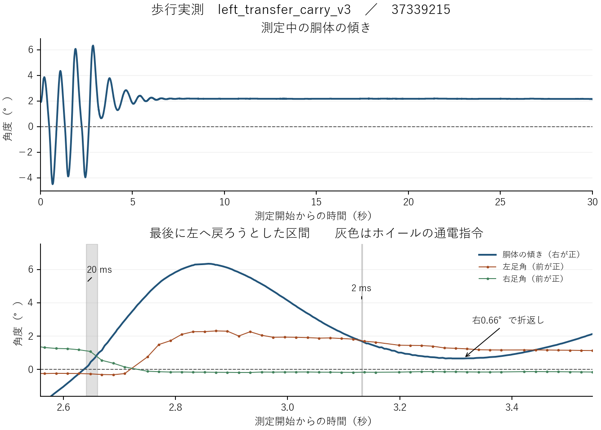

# walk3実走　中心まで右0.66°を残して折返し、最後の左補助は2 ms

2026-11-22の試行 `37339215` は `walking-support-transfer-v39-walk3`、`left_transfer_carry_v3`。目標選択は±8°、停止に関係する区間の始動目標は4.5°。直前のwalk2実機試行と比べると、中心を左へ越えた回数が半減した。停止までの床上前進距離は今回のRWLOG単体では測れない。

| 実機測定 | walk2　41749536 | walk3　37339215 |
|---|---:|---:|
| 胴体が機械的0°を右から左へ通過 | 6回 | 3回 |
| 左右交互に検出した胴体のピーク | 13回 | 7回 |
| 最終通電の終了 | 5.714秒 | 3.134秒 |
| 最後に左へ戻ろうとして折り返した位置 | 右4.01° | 右0.66° |
| 最後5秒の胴体角中央値 | 右5.80° | 右2.17° |

## 入力を決めた時点と結果



- **2.249秒**　中心を左へ通過した後の主入力は、要求80 ms、ホイール回転による制限後77 ms。実行記録は78 msとなり、左ピーク3.96°に達した。walk3はこの78 msを左主入力の予約時間として覚えた。
- **2.639秒**　右への中心通過速度は28.15°/s。右主入力は39 msから20 msに制限され、実通電も20 msだった。右到達モデルは、実通電時間から345.7 µJを予測した。実際の右ピークは6.34°、同じ機上の位置エネルギー式で521.1 µJ相当だった。目標は343.9 µJ。到達エネルギーを175.4 µJ過小に見積もった。この4.5°での右側制限は旧版でも動く。今回の停止は新版が追加した5°用分岐では評価できない。
- **3.129秒**　胴体右1.77°、左向き速度12.50°/s。左足は前方1.86°、右足は−0.17°だった。制御は93.3°/s²で減速し、惰行なら0.84°しか進まないと推定した。必要な追加仕事は36.64 µJ。ところが、中心通過後の左主入力用に78 msを先取りし、半周期80 msから引いた**残り2 ms**で電流指令を解いた。選んだ2 msの予測仕事は0.18 µJで、要求の約0.5%。通電前から36.46 µJ足りないと記録していた。足裏形状から時間を延ばす処理は `no_fresh_shape`、前後の傾きによる入力禁止はなかった。足角の定周期値はこの時点で取得できていた。
- **3.131～3.134秒**　ドライバの受理時刻は3.131148秒に−1200 mA、3.133526秒に0 mA。実電流標本は3.13256秒に−7 mA、3.13956秒に−17 mA。電流立上がりのモデル時定数31.65 msに対して短い指令であり、読出し間隔からパルス中の最大実電流は特定できない。残り78 msは実際には使われなかった。
- **3.28～3.31秒**　胴体は右0.66°付近で折り返した。確認用の0.20°逆行は3.398秒。3.30秒の左足は前方1.39°、右足は−0.12°。その後は中心を越えず、最後5秒の角速度絶対値の中央値は0.055°/s、足角の中央値は左+0.80°、右−0.13°だった。

初回補助後の再判定をwalk3の本番観測器で再生すると、再判定の準備状態には入ったが2回目の補助を選ばなかった。再現に使えるCAD記録は4枠で間に1枠の欠測があり、追加しなかった全ての実行条件を個別に断定することはできない。中心を越えないと使えない主入力に78 msを予約して最初の不足を放置した処理は、予約・要求・通電時間の記録と実装から特定できる。次の入力を増やした効果は実走で評価する必要がある。

## 右側の到達予測はこの1件だけ外れたのか

始動目標4.5°で右へ機械的中心を通過し、手前の半周期に補助を使わず、通常の主入力が計画時間まで実行され、次の右ピークまで他の通電がない区間を比較した。予測は受理した通電時間・開始時電流・電池電圧に基づく。図表の「実測相当」は実際のピーク角をファームと同じ位置エネルギー式へ代入した値で、モータの機械仕事を直接測った値とは区別する。

機上に右到達モデルの予測値が残る5走7件では **7件とも過小予測**。実測相当から予測を引いた差は+98.5～+232.5 µJ、中央値+127.9 µJだった。そこで時系列順に、該当する最初の2走（195727101、135284989）の通電3件の残差中央値169.7 µJから補正量を決め、後の3走（68907120、41749536、37339215）を分けた。既存フィードバックと同じ目標エネルギーの25%を上限にすると、この始動目標の補正上限は86.0 µJ。全候補に加える方法と、さらに候補の通電による予測増分で頭打ちにする方法を比較した。後者なら惰行の予測は元と同じになる。

| 元の各走で実際に与えた電流指令 | 件数 | 元の予測の平均絶対誤差 | 一定の正補正 | 通電による増分までの正補正 |
|---|---:|---:|---:|---:|
| 11月22日、後の3走の通電 | 4 | 132.0 µJ（1.41°） | 46.0 µJ（0.45°） | 51.9 µJ（0.51°） |
| 11月22日、先の2走の惰行 | 1 | 80.8 µJ | 5.2 µJ | 80.8 µJ |
| 元モデルの11月20日学習8走のうち、比較できた通電 | 15 | 99.0 µJ | 151.3 µJ | 151.1 µJ |
| 同じ8走のうち、比較できた惰行 | 7 | 36.8 µJ | 106.8 µJ | 36.8 µJ |

元の電流指令時の誤差と、指令を変更した際の実機応答は別に評価する。11月22日後半3走の元の計画時間22・18・25・20 msに対して、一律補正は4・0・9・0 ms、通電増分までの補正は15・13・17・14 msを選ぶ。変更後に実際の右ピークがどこまで届くかは未検証。後半3走には同じ採点条件の惰行が1件もなく、最新の20 msを0 msにして渡れる根拠は薄い。元の8走では通電時の誤差の向きも12件が逆だった。全走共通の固定補正にはせず、補正するなら直近の似た右入力で実測した系統差を使い、惰行を含めて確認するのが妥当である。[補正比較の再現コード](right_arrival_bias.py)

## ログの取得と再現

ファイルは2,648,784 bytes、CRC一致。サンプル9,762件、カメラ1,881フレーム。測定状態は30.000秒で `FINISHED`、制御イベントの省略・オーバーフローなし。定周期足角は1,199枠が記録され、周期の欠落0、両足有効1,196枠だった。取得時に何回切れたか、どのHTTPリクエストが失敗したかは、保存後のRWLOGに記録されない。

```powershell
$run = Join-Path $env:TEMP 'walker_walk3_20261122/37339215'
$previous = Join-Path $env:TEMP 'walker_walk2_20261122/41749536'
python -B tools/convert_rwlog_to_csv.py "$env:USERPROFILE/Downloads/energy_control_autonomous_run_1_37339215.rwlog" --out $run
python -B analysis/2026-11-22-walk3-trial/audit_run.py $run $previous
python -B analysis/2026-11-22-walk2-trial/post_aid_replay.py (Split-Path $run)
python -B analysis/2026-11-22-walk3-trial/right_arrival_bias.py "$env:TEMP/walker_arrival1_verification_20261122" "$env:TEMP/walker_trial_20261122" "$env:TEMP/walker_walk1_20261122" "$env:TEMP/walker_walk2_20261122" "$env:TEMP/walker_walk3_20261122"
```
