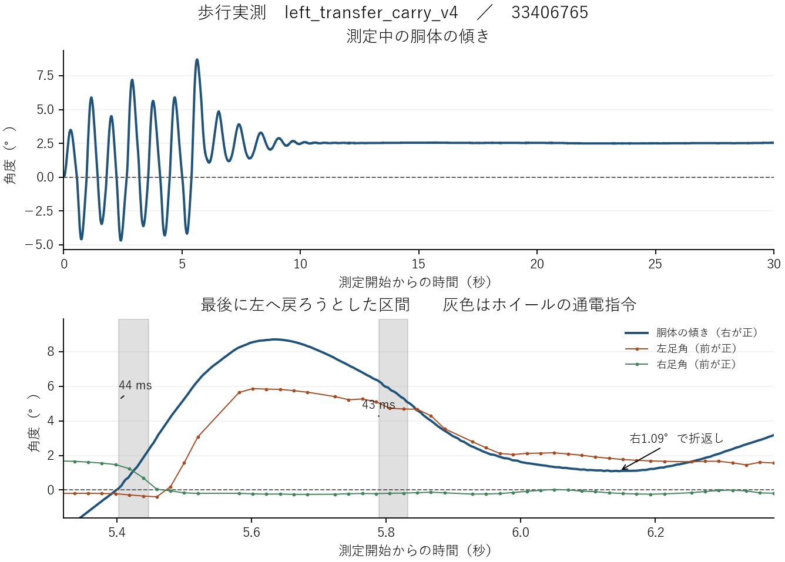

# walk4 実走　6回左へ中心を通過し、最後は右1.09°で折り返した

試行 `33406765` の実行版は `walking-support-transfer-v39-walk4`、制御方式は `left_transfer_carry_v4`。右から左への中心通過は6回、検出した交互の胴体ピークは13回。直前のwalk3は3回・7ピークだった。今回は約6.15秒で中心の右1.09°まで戻って折り返し、その後は右側で減衰した。最後5秒の中央値は胴体右2.52°、角速度絶対値0.073°/s、左足角+0.97°、右足角−0.16°。保存された2,690,527 bytesのCRCは一致し、30秒の測定を正常終了。足角は1,199枠中1,192枠で両足有効、定周期の欠落は0だった。床上の前進距離と接地荷重はこの記録からは測れない。



| 同じ試行の左補助 | 通過できた3.151秒 | 折り返した5.787秒 |
|---|---:|---:|
| 補助判断時の胴体角 | 右1.71° | 右6.37° |
| 左への角速度 | 17.17°/s | 18.32°/s |
| 制御側で取得済みの左右足角（前が正） | 左+2.21°、右−0.15° | 左+5.22°、右−0.21° |
| ソフトウェアの実通電時間 | 32 ms | 43 ms |
| 胴体の結果 | 3.198秒に左向き48.78°/sで中心通過 | 6.146秒に右1.09°で折返し |

最初の補助では中心を越えた時点で再計算し、主入力を0 msとした。最後の補助のひとつ前には、5.401秒に右の主入力44 msを選んでいる。このときの始動目標は5.5°、通常の到達予測は435.8 µJ。実際は右8.70°まで振れ、同じ位置エネルギー式で837.7 µJに相当した。4.5°、5°用の右到達制限はこの5.5°の状態では動かない。

最後の左補助は足姿勢を用いた通常の失速検出（`return_evidence=1`）。要求122.24 µJを満たす計算幅49 msからホイール回転を考慮して43 msを選んだ。ドライバ指令は5.788589秒に−1200 mA、5.831753秒に0 mA。実経過に基づく仕事予測は96.90 µJで、この低速域では外挿値。実電流の左向き積分値は通電中7.95 mA·s、解除から折返しまで22.10 mA·s。半周期の残りは37 ms。中心通過後用の履歴77 msは記録されたが、この検出種別では最初の入力幅から差し引いていない。

電流を切った約13 ms後の5.845秒、胴体は右4.63°地点で左向き41.64°/sに一時加速した。その後5.926秒には右2.54°地点で18.94°/sまで低下した。CAD上で左足が受け側に移った最初の記録は5.851秒の状態（計算完了5.860秒、足角の元画像5.805秒）。これは実際の荷重移行時刻の測定値ではない。エンコーダ位置から求めた反作用仕事の5点推定では、解除後14.9 msまでは+50.1 µJ、その後131 msは−59.5 µJ（9点推定は後半−52.0 µJ）。軸の反作用仕事と到達仕事モデルには異なる定義を使う。[反作用の再計算](../2026-11-22-walk2-trial/release_work.js)

walk4の追加補助は出なかった。旧判定は有効な速度の範囲5～35°/sで、それまでの最高速度から失った運動エネルギーが最初の補助の全仕事に達することを要求する。左側係数でこの範囲の最大差を計算しても79.12 µJなので、今回は96.90 µJを満たす標本が存在し得なかった。終了後150 msの再生でも6枠がそろい、再判定は0回だった。17走の左補助36件では、残り時間がありながら最初の仕事が79.12 µJを超えた実例は4件。そのうち3件では元の補助で中心に届いているので、追加入力を使い分けるには現在位置、残り距離、連続した減速を照らす必要がある。[旧判定](../../src/return_observation_policy.h) · [追加補助の時系列再生](../2026-11-22-walk2-trial/post_aid_replay.py)

```powershell
$run = Join-Path $env:TEMP 'walker_walk4_20261122/33406765'
python -B tools/convert_rwlog_to_csv.py "$env:USERPROFILE/Downloads/energy_control_autonomous_run_1_33406765.rwlog" --out $run
python -B analysis/2026-11-22-walk3-trial/audit_run.py $run --figure analysis/2026-11-22-walk4-trial/last_return_33406765.png
python -B analysis/2026-11-22-walk2-trial/post_aid_replay.py (Split-Path $run)
```
