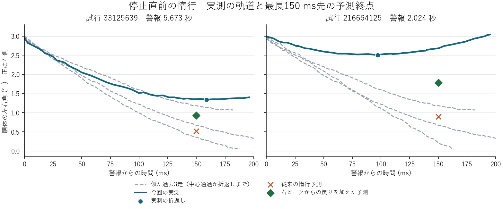

# 実走データで支持移行を再生する

11月20日の小型機のRWLOG 10走から、**右に振れた胴体が左へ戻る途中で、機械的な中心を越えるだけの勢いが残るか**を予測する。任意の判断時刻から、惰行、すぐに通電、同じ幅で開始を遅らせる候補をPC上で比較できる。配布中の `arrival1` の実走データはこの10走に含まれていない。

## 現在の通電比較に使うモデル

右ピークを離れてからの経過時間と、そこまでに戻った角度から求める平均速度を、従来の左右足角差・胴体角速度・減速・ホイール電流に加えた。これにより、一瞬の速度が似ていても、ピークを離れて加速中の状態と、すでに運動を失いつつある状態を区別できる。学習区間の末尾に残る25 ms未満の観測も、長さに応じて使う。先行8走から1走ずつ外して候補を比較し、惰行と実通電のどちらにも同じモデルを使う。通常の `--at` と新規試行の評価に反映済み。[運動の予測と比較方法](phase_dynamics.py)

* 左補助から1.91°内側へ進んだときの速度誤差（平均絶対誤差）は、先行21件で8.97→8.08°/s、直近3件で5.36→4.47°/s。turn3最後の19 ms補助では、実測18.95°/sに対して予測31.43→28.34°/s。改善後も9.39°/sの過大推定が残った。直近3件では2件で誤差が減り、1件で増えた。
* +3°から惰行する場合、最初に起きる中心通過・折返し・150 ms経過の時点での速度誤差は、先行108件で4.87→3.05°/s、直近8件で7.31→5.41°/s。終了条件の種類が実測と合った件数は99→102件と6→6件だった。旧・新の両方が同じ終了条件を正しく予測した例に絞ると、先行98件で4.41→2.73°/s、直近6件で7.10→5.73°/s。予測と実測の速度単位を揃えるため、同期ZEROイベントのMEKF補正値を記録されたジャイロ尺度と通電前のバイアス差で学習系列に換算した。先行97件、直近5件のZEROにこの方法を使った。別の通電が間に入る場合は惰行の評価を打ち切る。
* 小歩幅の2.024秒で追加通電をしない条件では、150 ms後の内向き速度の予測が11.85→1.99°/sになった。実際は97 ms後に折り返した。失速の程度は近づいたが、この局所予測自体は折返しを検出していない。下記の失速警報で使う類似事例の判定とは別に評価する。
* 足角速度は、判断時に公開済みの別々のカメラ画像について撮影時刻と足角から求める。直近2走の+3°時点で最新画像の左足は約3.47°前で、直前4画像の勾配は−3.16、−4.13°/sだった。画像は63、68 ms前のもので、この傾向から接地瞬間の足速度は決まらない。足角速度をそのまま類似例の選定に加えると、同じ直近9件で中心到達速度の誤差が5.22→7.91°/sに増え、折返し2件を両方見逃した。足位置を後から届いた画像と比較しても、現在の機上補償が直近263足観測で0.101°、最終観測値の保持で0.116°だった。通常の失速判定には従来の足角差を使う。[足角と足角速度の照合](foot_phase_check.py)

**次の支持まで届いたか**は、判断時点までに計算が完了した機上CADの記録で照合する。胴体が右の+3°へ戻った時点で、直近2件の左の円弧端は−1.906°付近。直近1走目ではこの端までの惰行エネルギー余裕は−1.186 mJ、2走目は−0.681 mJと機上の診断計算が推定しており、両方とも到達前に折り返した。これはエネルギー不足のモデル値で、接地力の測定値ではない。受け側の基準が確定している場合、通常の `--at` はこの角度を目標として表示する。正側で学習した連続予測は機械的な0°までに制限し、実際の走行で負の端に届いたかは独立に照合する。区間中の通電は惰行の検証から除外する。受け側の基準がまだない時刻は、従来の1.91°分の局所移動を比較する。[受け側の終端と実測の対応](receiving_carry.py)

turn3の最後の19 msを、同じ5.567秒の状態からすぐに開始する場合と、記録どおり27 ms待つ場合で再計算すると、+3.47°到達時の速度は31.61対32.52°/sだった。この差0.91°/sは通電例の予測誤差より小さく、待つ方が有利という根拠にはならない。この半周期ですでに通電した後の5.673秒に2発目を追加する案は既存制約にかかる。

**実際に左向きのZEROを越えた時点**では、そこで決まった通常通電の幅・予測電荷、通過速度、足角差と受け足の端が近い別走から、端までの運動エネルギー変化を推定できる。先行の左向きZEROは115件。当時すでに端が確定していた47件のうち、到達速度は45件で測れた。近い条件が別の2走以上にある10件で、到達速度の誤差は定速の7.01°/sから4.54°/sに減った。直近で終端まで実測できた2件の速度は23.54、19.98°/sで、類似条件は各0走・1走だったため予測を保留した。この段階の予測は実際にZEROに到達して初めて使える。折返した半周期を成功例から外挿していない。[ZERO通過後のモデル](post_zero_carry.py)

## 実測で良くなった予測

先行8走でモデルを作り、先行走を評価する際はその1走を丸ごと除外した。後の2走は係数・事例の選定から除外した。この2走の停止は以前から分かっており、設計後に収録した未知の実験による検証はこれからである。

| 右ピークから左へ戻る半周期 | 先行8走 | 直近2走 |
|---|---:|---:|
| 右ピーク総数 | 123 | 10 |
| 判断後に別の通電が加わり、惰行との比較から除外 | 4 | 1 |
| 最初の判断位置まで届かず | 2 | 0 |
| 評価できた折返しのうち予告できた件数 | 4 / 5 | 2 / 2 |
| 中心を通過したのに停止を予告した件数 | 3 / 112 | 0 / 7 |
| 同じ機会に直前の角加速度だけで外挿した場合の誤警報 | 14 / 112 | 1 / 7 |

右ピークの確定後、左へ向かって+3°を通ったときに判定し、+2°を通れば再計算する。その時点の胴体角速度、過去約25 msでの速度変化、公開済みの左右足角の差に最も近い3走を使う。3走の過半数が中心へ届かず、3件目までの正規化距離も基準内なら警報を出す。3件は独立した走行から各1件であり、通過頻度は校正済みの確率として扱えない。最新の足観測が75 msを超えて古ければこの判定を保留する。[判定と評価](return_model.py)

直近2走では、+3°での中心到達速度の平均絶対誤差は、定速外挿で11.14°/s、胴体だけの類似事例で6.26°/s、足角を含めると5.14°/sだった。先行8走の対応値は8.43、4.90、3.70°/s。いずれも到達前に折り返した場合の到達速度を0と定義した。

| 記録した試行 | 最初の警報 | 実際の折返し | 警報から折返しまで |
|---|---:|---:|---:|
| 33125639・turn3 | 5.673 s | 5.832 s、+1.34° | 159 ms |
| 216664125・v14式小歩幅 | 2.024 s | 2.121 s、+2.50° | 97 ms |

両方で、似た3走のうち2走は中心へ到達できなかった。各例で角速度をrad/sに直して計算した中心到達時の運動エネルギーを慣性で割った値（½ω²）の中央値は0だった。小歩幅試行では到達速度の3例平均は5.35°/sで、既存制御の余裕の目安5°/sを上回っていた。そこで平均速度だけで判断せず、各例で目安を下回るエネルギーを計算してから集約する。足への荷重や実効慣性は直接測定していない。



## シミュレーションで選んだ改善

+3°の位置に来る前に止まった先行例を受け、起動振幅の目安と同じ**+4.5°で早期監視を一度加える**方式を作った。+3°・+2°では引き続き判定を更新する。早期監視はモータを駆動せず、次のログでも通常の警報と区別して時刻を出す。

先行8走の**同じ115半周期**で二段・三段の監視を比較した。折返し7件の検出は4件から6件へ増え、中心通過108件での誤警報は1件から4件に増えた。新しく拾った2件は折返しの271 ms前と116 ms前だった。+4.29°で折り返した1件は引き続き見逃した。直近の小歩幅試行では最初の警報が1.934秒になり、折返しの187 ms前、従来より90 ms早い。この比較に使える直近の中心通過6件には誤警報がなかった。もう一方のturn3では+4.5°を通過した時点で19 msの補助を実行中だった。

早い判断時点で通電中、またはそこから折返し・中心通過までに追加通電があった半周期は、早期監視の惰行比較から両方式とも除外した。このため上の二段だけの評価と分母が異なる。+4.5°は失敗を見てから選んだ位置であり、この成績での自動通電は採用していない。[同じ半周期での比較と走行別の集計](add_early_watch.py)

## 初版の通電予測で分かったこと

25 msごとの胴体速度の変化を、足角差、胴体角と角速度、直前の速度変化、右ピーク、ホイールの予測電流から推定する。立上がりには判断時の電流モデルを、通電後には70 msの減衰時定数を使う。候補の開始時点以降は実測の将来の足角・胴体角を読み込まずに進め、短い予測区間では足角差を固定する。指定角への到達、折返しのうち最初のイベントで終了し、150 ms以内にどちらも起きなければそこで推定を打ち切る。直立時の足裏形状の参照角はCAD寸法から asin(5/150) ≈ 1.91°。実際に左右の足への荷重が移った角度は足の前振れで動く。[通電と運動のモデル](action_model.py) · [機体の支持移行計算](../../src/support_transfer_plan.h)

過去に実行した左補助を同じ判断時刻・同じ幅で再生し、そこから1.91°内側へ進んだときの速度を照合した。先行8走の21件で、速度の平均絶対誤差は電流を省いたモデルの13.06°/sから8.97°/sに減った。直近はturn3の3件のみで、6.57°/sから5.36°/sに減った。直近で3件とも予測イベントには到達したが、そこからさらに中心へ戻る際に速度を失う例がある。

* turn3の5.592秒に判断し、5.594秒に開始した19 msの補助では、+2.95°到達時の速度を31.43°/sと推定したが、実測は18.95°/sだった。5.673秒の警報時点には、同じ半周期ですでに補助が入っている。そこで2発目がかかる制約を表示し、元の判断の25 ms前（5.567秒）に巻き戻して**同じ19 msの開始だけを動かす**比較も出す。この共通の状態から+3.47°へ向かう速度予測は、即時開始で33.86°/s、記録と同じ時刻から開始すると34.98°/s。差は1.12°/sで、直近3件における速度予測誤差の大きさが上回る。この結果から優劣は選べない。巻き戻し時刻は実際の判断を見て事後に選んだ。
* 小歩幅の2.024秒では、惰行でも約77 ms後に+1.91°へ届くと局所モデルが推定した。実測では+2.50°で引き返した。この状態に近い左補助実績は0件。先行21件の補助幅は12〜37 ms、実際の開始は判断から1〜3 ms後に集中しており、25 ms遅らせたときの効果は実測で識別できていない。
* 右へ向かう通常ZEROでは、実行済みの元幅、現行 `arrival1` の幅、同じ起動目標・近い速度・直前ピーク・電荷で実例のある幅を比較する。直近で18 msを選ぶ3状態は近傍の通電実績0件。元の上限の範囲で幅を増やすと、27 msで先行2走の実例が初めて得られる。turn3の3.469秒では元43 ms、現行18 ms、比較27 ms。近い3件で実際に使った幅は24〜32 ms、次の左ピーク到達は2/3件で、右ピーク後に追加通電した例も1件あった。同じ過去例を別の判断時刻でも参照するため、件数の重複に注意。[右入力の比較条件](right_candidates.py)

このため、現段階で採用する改善は、戻りの途中で繰り返しエネルギー不足を評価し、**追加通電と、元の通電を早める案を別々に試せること**。出力幅の最適値と床上速度は未確定。次の実走は直進の同条件で、中心到達速度、次の反対足の前進、同じ時間窓の床上前進距離を対応づける。

## 床に対して歩いたか

別途、床格子で追跡できた先行3本の映像とログを再照合した。最初の12秒に中心を越え、次の受理ピークまで足を追跡できた48半周期で、予想した側の足が他方より前に動いたのは47件。その足の白印自体が床格子に対して前へ動いた条件も満たすのは46件。左右の白印の中点が最初の12秒に進んだ距離はturn1で8.50小区画、続くturn2の2走で2.50、4.01小区画。最後の2走の8〜12秒の前進量はいずれも0.01小区画未満だった。約30 fpsの映像と白印の射影からの推定で、着地時刻・真の接触力・絶対距離は未計測。直近2走や未実行の通電候補の歩行結果とは区別する。[床上観測値](floor_observations.csv) · [測定と集計](floor_check.py)

### 以前の小歩幅試行とも照合した

11月13日のv14実走2本（172594684と294107213）は、学習の8走に入れずに検証した。右ピークから左向きに実際に中心を通ったのは39回と40回。左右の足角の校正は共通だが、この版では、制御に観測が届いた時刻を復元できるのは1走64フレームに限られる。実際に足角が届いており、判断時の画齢75 ms以内、かつ判断後に追加の入力がなかったという同じ条件で新モデルを採点できたのは、1本目の1半周期だけだった。この1件は通過を正しく予測した。残りを「警報なしの成功」に加えていない。古い試行は胴体が中心を繰り返し越えていたことの比較基準にはなるが、この足角モデルの精度を独立に裏付けるには観測が足りない。

## 再生方法

リポジトリ直下で実行する。Python 3.9以降、NumPy、右の機上処理も比較する場合は `g++` が必要。標準ではDownloadsの原本を一時ディレクトリに展開し、プロジェクトのコンバーターでCRCを確認する。変換済みの10走がある場合は `--recordings <試行ID別のフォルダが入った親フォルダ>` で再利用できる。生データは変更しない。

```powershell
$sim = 'analysis/2026-11-22-walking-simulator/simulate.py'
python -B $sim --json-out "$env:TEMP/walking-simulation.json"
python -B $sim --at 216664125 2024 --widths 0 10 20 --delays 0 25 --section-deg 0
python -B $sim --part floor
python -B $sim --part carry
```

次の走行では `python -B $sim --evaluate-run <新しいRWLOGのパス>` を使う。同じ先行8走を基準に、各右ピークの警報時刻とその後の実測を出す。元ログからの再計算には8本の参照原本と新しいRWLOGが必要。互換の足角・IMU・イベント記録を持つ同型機の試行を対象とする。JSONには予測不能・後続通電・観測打切りも含む。図は `plot_warnings.py <全件のJSON> <変換済み10走の親フォルダ> <出力PNG>` で再生成できる。

11月13日の参考評価は `legacy_check.py <11月20日の参照8走の変換先> <11月13日の2走の変換先>` で再生できる。各親フォルダの下に試行IDのディレクトリを置く。[旧版の受領時刻と通電を照合する処理](legacy_check.py)
