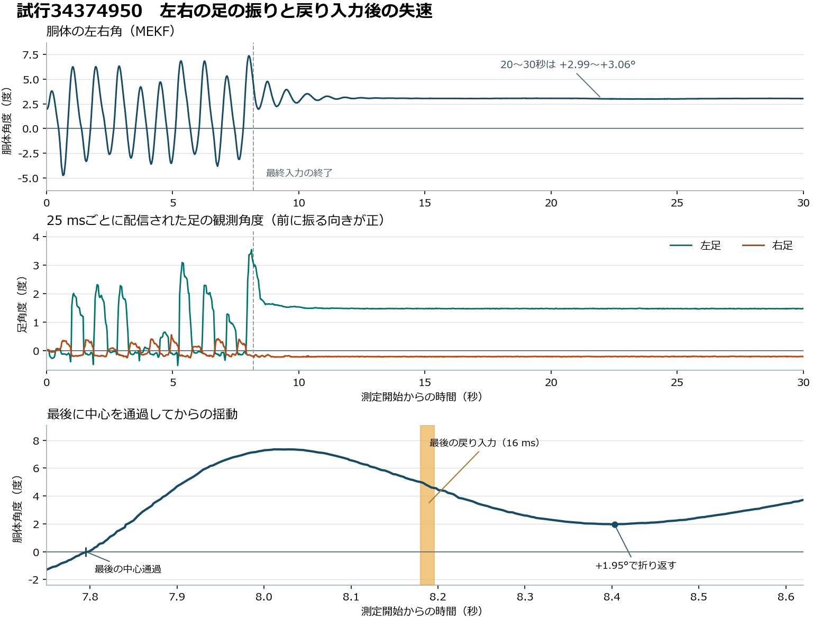

# 試行34374950の歩行と足角度

RWLOGと同時に保存された診断JSONは、どちらも実機のビルドIDを `walking-support-transfer-v39-walk5-logfix1` と記録している。診断にある歩行設定は `left_transfer_carry_v5`。この測定はwalk6の実機評価には使えない。



| 測定開始から | この試行で観測したこと |
|---|---|
| 0.216～8.032秒 | 機上で記録した9周期の足の振り幅の中央値は左2.39°、右0.54°。最後の周期は左2.92°、右0.58°。9周期のうち8周期で左の振り幅が右より大きい。右の振り幅の最大は0.63°。 |
| 7.795～8.196秒 | 胴体が最後に中心を越えたのは7.795秒。8.025秒に正側のピーク+7.36°に達した。戻り補助の指令は8.180～8.196秒に−1,200 mA（選択幅15 ms、実経過16 ms）。その間に−94 mA、解除後にさらに−124 mAを観測した。 |
| 8.403秒付近 | 中心に最も近づいたときで+1.95°。反対の支持側まで届かず、同じ側に揺り戻した。通電予算は64 ms残ったまま、その後は測定終了まで次のモータ入力がない。旧版には静止からの復帰機能がない。 |
| 20～30秒 | 胴体角は+2.99～+3.06°、足の観測角は左+1.46～+1.49°、右−0.23～−0.20°。左右の足を振り直す動きは確認できない。 |

最後の入力時、旧版の計算にはエネルギー不足20.24 µJ、選択幅での予測仕事13.21 µJ、残り7.03 µJが記録された。これらはモデルの推定値。足の接地力、床面上の歩幅・移動距離、左右の荷重はこのログで直接測っていない。9周期の `gait_turn` 記録のうち3周期では右の振り不足の候補が出たが、いずれもヨーの確認条件に達せず、旋回判定は成立しなかった。

RWLOG v56は2,712,947バイト。CRC32は `b5565b51` で一致し、測定は30秒で `FINISHED`。時系列は9,793行、カメラは測定中1,410フレーム。25 ms周期の足角配信は1,200枠すべてを記録し、1,198枠で両足が有効（99.83%）。配信中の画像取得時刻がすべて別フレームという意味ではない。

## 再確認するには

```powershell
python -B tools/convert_rwlog_to_csv.py "$env:USERPROFILE/Downloads/energy_control_autonomous_run_1_34374950.rwlog" --out "$env:TEMP/walk6_34374950_meas"
```

図の胴体角は `timeseries.csv` の測定中（`state_id=3`）の `pitch_mekf_abs_deg`。足角は `foot_periodic.csv` の `left_observed_deg` と `right_observed_deg` を配信枠の `slot_us` に対して描いた。周期ごとの振り幅には `gait_turn.csv`、通電の開始・終了・残り予算には `walking_energy.csv` を使った。
