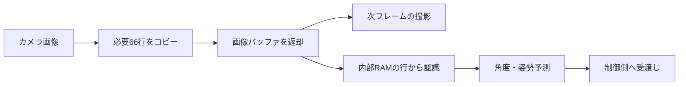

# v20：足角度認識の低遅延化

`atoms3cam-foot-fast` / `walking-foot-fast-v20`。エネルギー制御はv19のrevision/branch24を維持し、カメラ・画素処理・観測の受渡しを変更する。旧v19環境と配信物を保持する。

## 遅延の内訳

過去3試行の測定中フレームを、認識失敗も含めて集計した中央値。カメラのdriver timestampと実際の露光時刻の関係は未校正で、以下を露光遅延の実測とは呼ばない。

|段階|62788986|39825069|28820005|
|---|---:|---:|---:|
|フレーム周期|100.000ms|100.000ms|100.000ms|
|driver timestamp→画像受取|50.400ms|50.437ms|50.508ms|
|画像認識処理|12.648ms|12.835ms|12.779ms|
|姿勢予測全体|0.216ms|0.230ms|0.199ms|
|driver timestamp→保存された制御受取|68.649ms|68.648ms|69.253ms|

制御受取は各64件の均等間引き記録であり、空欄を未受信や0msへ置き換えていない。姿勢予測全体にはlocal処理が含まれるので二重加算しない。受取時刻と認識完了時刻も区別した。解析器は `tools/analyze_foot_latency.py`。

認識処理だけでなく、画像更新が10Hzに留まる点が大きい。実SDKはArduino2.0.16 / IDF4.4.7 / esp32-camera `f0bb429`。単一fbでは、フレーム完了直後の再開時に空きがなく次VSYNCを待つ。早く返すだけで100→50msになるとは言えない。[当該ドライバ](https://github.com/espressif/esp32-camera/blob/f0bb429/driver/cam_hal.c)

## 撮影と認識を重ねる

v20はQVGAグレー・XCLK20MHz・元の校正を維持し、2fb＋LATESTにする。driverの待ちキューは1枚で、借りている画像は返却まで上書きされない。live streamを `cam_take(0)` で掃除しない。当該S3 driverは空キュー受信時にDMAをresetし得るため、LATESTの置換に任せる。

コード上はグレーでも構成できるが、当該公式READMEは複数fbをJPEG用途に推奨している。グレー2fbはCPU/PSRAM負荷と制御遅延を実機で確認する実験構成で、実fpsの改善を保証しない。[公式README](https://github.com/espressif/esp32-camera/blob/f0bb429/README.md)

画像を受け取ったら、探索で必要な66行・21120bytesを内部RAMへコピーする。idle時の画像表示用サムネイルも別のPSRAM領域へコピーする。その後camera fbを返し、認識はコピーだけを参照する。元画像を返却後に参照しない。

認識は行方向の整数加算に変更し、PSRAMの画素へ繰返し飛ぶ参照を減らす。左右の全17高さ、全幅、閾値、曖昧性、再捕捉、角度換算は維持する。旧コードでは両足1フレームで論理上87040bytesを元画像から読む。cacheの元画像コピーは21120bytesで、以後は内部RAMを参照する。これは論理読取り数で、実バス帯域の計測ではない。

workerの最短周期は66.667→40ms、制御側の観測pollは10→2ms。25fpsは設定上の目標上限であり、センサの実fpsではない。既存の姿勢予測が40ms未満をGapとする条件は変更しない。

## 精度・所有権・容量の確認

凍結した旧認識器との13256観測比較で、同一画像・同一時刻列に対する観測値と判定がbit一致した。全探索、境界、8種類の理由、再捕捉、欠落、時刻wrap、cache不足/無効化を含む。ホスト上は両足約0.139→0.053msだったが、ESP上の改善時間へ換算しない。撮影される画像列自体が増えるため、実機の認識精度は別途確認する。

実loopのhost検証では、fb返却時に必要66行は退避済みで認識は未実行であることを確認した。返却時に元画像を破壊しても、角度・予測・idle previewは非破壊時と同じ。active previewの保持、無効画像後に古いcacheを使わないこと、単回返却、ゼロ校正、時刻、40ms周期、archive境界、手動one-shotのreceiver/XCLK停止も確認した。RTOS・DMA実動作の一部はdoubleであり実機検証を代替しない。

足archiveは1280件へ増やす。v20のみmetadataのhard budgetを1MiB、事前PSRAM予約を1152KiBとし、旧版の640/768KiBを維持する。raw footとenergy/support監査を優先し、予測の複製テーブルは必要時 `truncated=true` で省略する。極限fixtureは985944bytesでraw足1280・energy192・support96件を全保存した。単純なPSRAM残り推計は約1.01MBで、実際のheap断片化・driver確保の余裕を保証しない。認識用内部RAM確保に失敗した場合は足観測を有効にせず、古い画像や部分行へ黙ってfallbackしない。

旧 `test_camera_coexistence.py` はPhase1N固定版の全ファイルhash/古い構成を検証する試験で、変更前v19のHEAD0ae7725自身でもhashが一致しない。旧試験は書き換えず、現行のcamera所有権・core/priority・SCCB・pipelineを新しい実source試験で検証した。v19実runner、5度許容、現行通信/UI/ログ形式にも回帰確認を行った。

## 新しい時刻と画面

`ready_us`は認識と姿勢予測が完了し、公開ロックへ入る直前の時刻。`released_us`はdriver bufferを返した時刻で、露光終了時刻ではない。`capture_wait_us`、`row_copy_us`、`recognition_us`、`row_cache_used`と全フレームの `control_observed_us` をJSON/CSVへ保存する。raw readyがある場合は予測テーブルが省略されても遅延を解析できる。0は欠測として扱う。

従来の `processing_us` は角度換算等も含む画像処理区間で、v20では行コピーやidle preview処理も含む。新しい `recognition_us` は左右tracker呼出しだけなので、両列を同じ処理範囲として比較しない。

画面に実fps、認識時間、driver frame→ready時間を表示する。初回は書込み後に**測定開始を押さず**、足を手で動かして角度・画像更新・fps・認識msを確認する。歩行測定の前にこの段階で認識の失敗・遅延を確認する。新しい撮影負荷でのIMU/制御遅延や歩行は未検証。

従来のブラウザ更新は応答後800ms間隔で、認識とは別の表示遅延があった。v20のREADY待機中・接続正常時は100ms間隔へ短縮する。測定・転送・preview・コマンド中、通信失敗、旧版では800msを維持する。HTTP応答時間は別にかかり、画面を10Hz更新できる保証ではない。

## 配信

専用ページは `http://127.0.0.1:8767/foot-fast/`。`python tools/prepare_foot_fast_flasher.py` で再生成する。最終ビルドはSUCCESS39.374秒、RAM127604/327680、Flash1917225/3342336。firmware1917584bytes、SHA256 `eebe1e4ceaf079c6309f9b83c2368ec55e8ff7fdca2b56b6dfdf94c55c50da2d`。

page・manifest・4部品・補助JS2件はHTTP200・全バイト一致。旧v19/v18の配信SHAを保持。今回、実機への書込みやモータ動作は行っていない。
